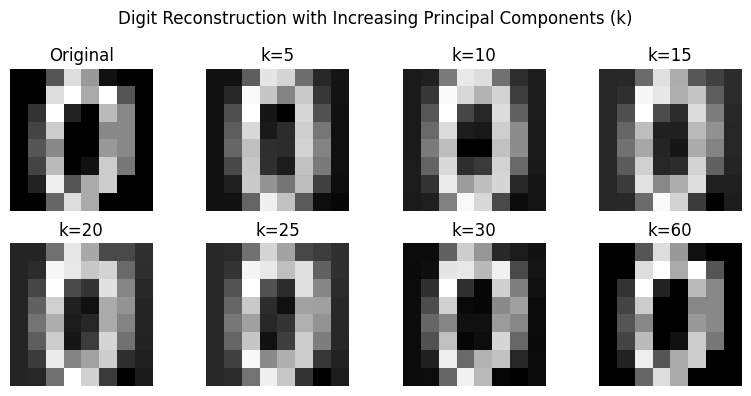
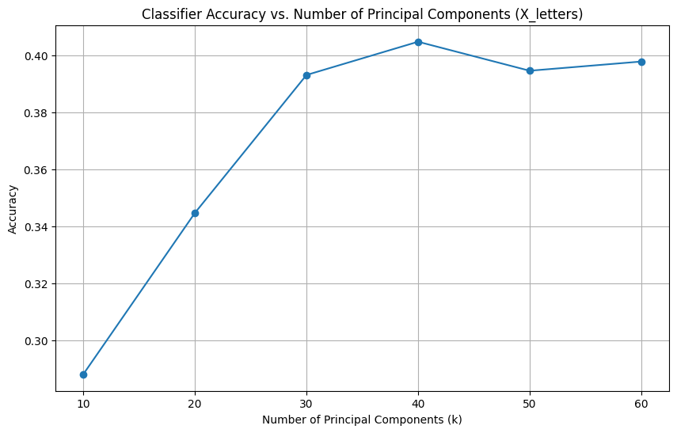

# 🧩 PCA Experiments (Digits + Arabic Letters Image Dataset)

A practical **PCA (Principal Component Analysis)** notebook that explores **dimensionality reduction** on two image datasets:

1) **scikit-learn Digits** (built-in; small grayscale digit images)  
2) An **Arabic letters image dataset** (grayscale images stored as flattened pixel vectors in CSV files)

The notebook focuses on understanding:
- **Explained variance** and cumulative variance
- Choosing the number of principal components (**k**)
- **Image reconstruction quality** after compression
- The impact of PCA on **classification performance** (e.g., Logistic Regression / KNN)

---

## 📸 Preview

<p align="center">
  
  
</p>
<p align="center"><sub>Digit reconstruction as k grows · Classifier accuracy vs. k on Arabic letters</sub></p>

---

## 🧠 What This Notebook Does

### 1) Load & Prepare Data
- Loads **Digits** using `sklearn.datasets.load_digits`
- Loads **Arabic letters** images from CSV files (image vectors + labels)

Typically, each image is stored as a **1D vector** (flattened pixels).  
Example: a 32×32 image → **1024 features**.

---

### 2) PCA Analysis (Explained Variance)
The notebook fits PCA and analyzes:
- `explained_variance_ratio_`
- cumulative explained variance
- scree/cumulative plots to determine how many components are needed to retain a desired variance level.

---

### 3) Reconstruction Experiments
The notebook reconstructs images using different values of **k** to visually compare:
- original image vs reconstructed image
- how compression affects clarity and details

This builds intuition about the trade-off between:
**compression** ↔ **information retention**

---

### 4) Classification After PCA
The notebook tests how PCA affects classification by training models on PCA-reduced features and evaluating performance.
Common experiments include:
- varying `k` (number of components)
- varying variance thresholds (e.g., 90%, 95%, 98%)
- comparing performance before/after PCA

Models may include:
- **Logistic Regression**
- **K-Nearest Neighbors (KNN)**

---

## ✨ Key Learning Outcomes

- Understand PCA beyond theory through real image experiments
- Interpret explained variance and choose `k` systematically
- Observe reconstruction quality changes as `k` changes
- Measure how dimensionality reduction affects classification accuracy
- Learn why splitting strategies (e.g., stratification) matter for fair evaluation

---

## 🛠️ Tech Stack

[](#)
[](#)
[](#)
[](#)
[](#)

---

## 📂 Project Structure

```txt
├── PCA_expirements.ipynb
├── (Arabic letters CSV files)            # optional (if available)
├── assets/
│   └── preview.png                       # optional screenshot
└── README.md
````

---

## ⚙️ How to Run

### 1) Install Requirements

```bash
pip install numpy pandas matplotlib scikit-learn
```

### 2) Launch Jupyter

```bash
jupyter notebook
```

Open:

* `PCA_expirements.ipynb`

> If you are using Google Colab, upload the CSV files to `/content/` (or update the file paths in the notebook).

---

## 📌 Note About the Arabic Letters Dataset (File Size)

The Arabic letters dataset files may be **too large to include directly in the repository** (or may fail to upload due to size limits).
If you want the exact dataset used in this notebook, feel free to **contact me on LinkedIn** and I can share it.

[](https://www.linkedin.com/in/mohammed-a-3913a5378/)

---

## 🚀 Ideas for Improvement

* Add `StandardScaler` comparison (scaled vs unscaled PCA pipelines)
* Try additional models (SVM, RandomForest, MLP)
* Benchmark runtime vs number of components
* Add PCA-based 2D visualization (and compare with t-SNE / UMAP)
* Automate best-`k` selection using validation accuracy

---

## 📚 References

* scikit-learn PCA Docs: [https://scikit-learn.org/stable/modules/decomposition.html#pca](https://scikit-learn.org/stable/modules/decomposition.html#pca)
* Digits Dataset (sklearn): [https://scikit-learn.org/stable/modules/generated/sklearn.datasets.load_digits.html](https://scikit-learn.org/stable/modules/generated/sklearn.datasets.load_digits.html)

---

## 🧑‍💻 Author

**Mohammed Alawfi**
📍 Madinah, Saudi Arabia

[](https://github.com/moalawfi)
[](https://www.linkedin.com/in/mohammed-a-3913a5378/)

---

## 📜 License

This project is licensed under the **MIT License**. See `LICENSE` for details.
